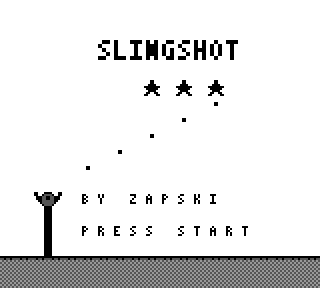
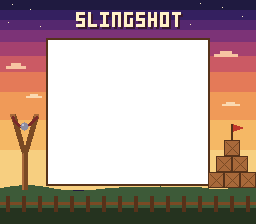

# GB-Slingshot



A slingshot physics-puzzle game for the original Game Boy. Pick an angle and a
power, choose one of four projectiles, and bring down structures of wood, stone
and ice to destroy every target before your shots run out.

Fifty hand-built levels, star ratings and a battery save, four projectile types
with a mid-flight ability, sound, dust and screen shake, and a Super Game Boy
border. Written in C with [GBDK-2020](https://github.com/gbdk-2020/gbdk-2020)
and no game engine. The ROM is a single 32 KB image.

**[How to play](play.md)** · [Build plan](gb-slingshot-build-plan.md)

## Features

- **50 levels** built from plain-text ASCII grids, with shot budgets tuned
  against a brute-force solver rather than guessed.
- **Four projectiles** — standard, boost, split and pierce — each with one
  ability spent on a second A press while the shot is in flight.
- **A physical world**: cells dent, crack, break, fall and land on each other.
  A collapse can destroy a target, and cells destroyed by a fall score double.
- **Star ratings** from the shots you have left, saved in cartridge RAM with a
  battery, so progress survives a reset.
- **A DMG game that becomes an SGB game**: on a Super Game Boy the cartridge
  installs a 256x224 border around the screen.
- **No engine, no floats, no 32-bit maths**: a header-only simulation shared by
  the Game Boy front end and the host-side tests.

## Play

You need a built ROM first: see [Building](#building). Then either

```sh
make run        # open build/slingshot.gb in mGBA
```

or load `build/slingshot.gb` in any Game Boy emulator or flash cartridge. On a
Super Game Boy, the border appears automatically.

The full manual — controls, materials, projectiles, scoring and strategy — is
in **[play.md](play.md)**. The short version:

| Input | Action |
|---|---|
| D-pad up / down | Angle (5°–80°, in 5° steps) |
| D-pad left / right | Power (8 steps) |
| B | Cycle projectile type |
| A | Fire |
| A while in flight | Spend the projectile's ability, once per shot |
| START | Restart the level, or load the next one after a win |
| SELECT | Back to the level select |

## Projectiles

| | Type | Ability on the second A press |
|---|---|---|
| **A** | Standard | None |
| **B** | Boost | Speeds up 50% on the spot, in the same direction |
| **C** | Split | Fans into three shards, each rotated slightly |
| **D** | Pierce | Turns into a drill that keeps flying through the cells it dents; ground still stops it |

The split fan is a cheap rotation (`vx ± vy>>3`, `vy ± vx>>3`) rather than a
trig table, and all three shards fly on the same step as a normal shot. A shot
ends when its last projectile is spent.

Eighteen levels declare the type they are built around (`# needs B`, for
example); the level select shows the requirement.

## Building

Requirements:

- [GBDK-2020](https://github.com/gbdk-2020/gbdk-2020) 4.4.0 (`lcc` on `PATH`),
  **or** Docker — the Makefile builds inside a container when `lcc` is absent.
- `python3` for the table, tile and level generators.
- `gcc` or `clang` for the host tests.

```sh
make                 # build/slingshot.gb
make test            # host-side simulation tests (no GBDK needed)
make check-asm       # scan the SDCC assembly for the cached-accumulator bug
make check-levels    # brute-force every level's shot budget
make emu-test        # replay the golden game in PyBoy (needs pyboy + pillow)
make sgb-test        # verify the SGB border transfer
make run             # build, then open in mGBA
make docker-image    # build the GBDK toolchain image used when lcc is absent
```

If GBDK is installed somewhere other than the path baked into `lcc`, set
`GBDKDIR` (with a trailing slash) and put its `bin` on `PATH`.

Without a local toolchain:

```sh
make docker-image                 # once
make
make emu-test PYTHON=.venv/bin/python
```

`make emu-test` needs `pip install "pyboy>=2.8.0" pillow`; `PYTHON=...` picks
the interpreter, defaulting to `python3`.

## Levels

Each level is a text file with rows of 20 characters, aligned to the bottom of
the grid:

| Character | Cell |
|---|---|
| `W` | Wood |
| `S` | Stone |
| `I` | Ice |
| `T` | Target |
| `.` | Empty |

Two optional directives set the rules:

```text
# shots 2
# needs C
```

`# shots N` is the shot budget (default 3) and `# needs A|B|C|D` declares the
projectile the level is built for (default A). Files play in name order, so
`levels/01.txt` is level 1. `tools/mklevels.py` turns them into `src/levels.h`.

Shot budgets are measured, not guessed: `./build/check_levels --par` prints the
minimum number of shots any search can win in beside the configured budget.
Most levels are set to par+1 — 29 levels run on two shots, 20 on three, and one
on four.

## How it works

The simulation is deliberately small: one header and no `sim.c`.

```text
src/sim.h            game logic: grid, materials, fixed-point flight, damage,
                     collapse, win/lose. Header-only, no hardware calls.
src/main.c           Game Boy front end: input, aiming, drawing, level select, save
src/tables.h         generated by tools/mktables.py (launch velocities)
src/gfx.c/.h         generated by tools/mkgfx.py (tiles)
src/levels.h         generated by tools/mklevels.py from levels/*.txt
src/sgb_border.c/.h  Super Game Boy border transfer (CHR_TRN/PCT_TRN)
levels/*.txt         the 50 levels, one ASCII grid each
tests/test_sim.c     host tests, including a golden replay
tests/emu_replay.py  replays the same golden game on the real ROM in PyBoy
tools/               generators, the level solver and the assembly checker
```

`src/sim.h` contains no `<gb/gb.h>` include and no hardware access. That is what
lets the same code run under gcc on the host and SDCC on the Game Boy: the
front end reads the pad, calls `sim_tick()`, and draws the result.

Some invariants worth knowing before changing things:

- **Fixed point.** Positions are whole pixels plus a separate 8-bit fraction
  (a 16-bit 8.8 value cannot hold 160 px); velocities and gravity are 8.8.
  There is no floating point and no 32-bit arithmetic in `sim.h`.
- **One flight step.** `proj_ballistic_frame()` is shared by real flight and by
  the dotted aim-preview arc, so the preview cannot drift from the shot.
- **Generated files.** `src/tables.h`, `src/gfx.*` and `src/levels.h` are
  outputs. Edit `tools/mktables.py`, `tools/mkgfx.py`, `tools/mklevels.py` or
  `levels/*.txt`, never the generated file.
- **Material ids are tile ids.** The `M_*` enum must stay aligned with the
  `TILES` order in `tools/mkgfx.py`; the renderer returns a material directly as
  a tile number.
- **The `Sim` layout is read by offset.** `tests/emu_replay.py` imports
  `OFF_*` constants from `build/sim_offsets.json`, regenerated from the real
  header before every `make emu-test` run. Add new fields last, and add any
  field the emulator test reads to `tests/sim_offsets_probe.c`.

### Testing

`make test` runs 1,400+ host-side assertions plus a golden replay whose FNV hash
pins the outcome of three fixed shots. `make emu-test` plays the same game on
the ROM in PyBoy and compares the grid hash, which is what catches SDCC-vs-gcc
divergence; it also checks the front end, the splashes, sprite animation, the
HUD, the chain flash and the battery save across two emulator sessions.

Any deliberate change to collapse or damage rules will fail the golden replay.
Re-record it with `UPDATE_GOLDEN=1 make test`, paste the printed hash into
`GOLDEN` in `tests/test_sim.c`, and update the matching constants in
`tests/emu_replay.py`.

`test_levels_are_winnable` brute-forces every angle/power pair and projectile
type on every level, and prints how many first shots win each one outright.
`test_late_levels_need_a_type` proves that every `# needs` declaration is true:
no standard shot may win the level, and the declared type must.

## Super Game Boy border

On a Super Game Boy the boot installs a 256x224 border around the game — a
launch rig at dusk, framing the screen in wood. The art is
`art/border_sgb.png`, drawn by `tools/mkborder.py` and converted to
`src/border_data.c` by `png2asset`. It costs about 6.3 KB of ROM.



The transfer is a round trip: the Game Boy copies the border into VRAM, draws it
in a known order, and the SGB reads the picture back. Everything is behind
`sgb_check()`, so a DMG boots exactly as before. `make sgb-test` is the guard —
it boots the ROM with SGB processing on and compares the bytes the SGB receives
against `src/border_data.c`.

## An SDCC note

SDCC's gbz80 backend compiles `field != other` as `sub a,(hl)` and leaves `A`
holding the **difference**, while still believing it holds `field`. Reusing that
value gets the difference instead, and nothing in the C source shows it. It
silently broke the win/lose splashes and the aim preview here.

The rule: **a field compared more than once must be `volatile`.** `sim.state`
is `volatile` in the `Sim` struct, which forces every read — including a local's
initializer — through memory. `make check-asm` builds the assembly and scans for
both shapes of the bug; run it whenever the toolchain changes.

## Status

Phases 0–5 of the build plan are complete: tooling, the simulation core,
rendering and aiming, the collapse animation and HUD, fifty levels with
progression and a battery save, and projectile variety. Phase 6 (polish) has
sound effects written straight to the APU, impact puffs, screen shake and the
Super Game Boy border. In-game music is still open.

The detailed build plan is in
[`gb-slingshot-build-plan.md`](gb-slingshot-build-plan.md).
